# BloomLater

BloomLater is a digital time capsule application. You write a message, memory, or note for your future self, choose when it should become available, and leave it sealed until that date arrives.

The app is only one part of this project. I also wanted to build and run it the way an actual cloud workload is delivered: code in Git, a Jenkins pipeline that checks and packages it, container images pushed to a registry, Kubernetes manifests kept in Git, Argo CD handling the deployment, and Prometheus and Grafana giving me a view of what is running.

The screenshots throughout this README are from the project while I was building, deploying, and checking it. They show the application, pipeline, and Kubernetes environment behind it.

## Table of Contents

- [A Look at BloomLater](#a-look-at-bloomlater)
- [Application Architecture](#application-architecture)
- [The Pipeline at a Glance](#the-pipeline-at-a-glance)
- [What Happens After a Push](#what-happens-after-a-push)
- [1. Jenkins Runs the CI Pipeline](#1-jenkins-runs-the-ci-pipeline)
- [2. Code Quality and Security Checks](#2-code-quality-and-security-checks)
- [3. Build and Publish the Images](#3-build-and-publish-the-images)
- [4. GitOps Hands Off Deployment to Argo CD](#4-gitops-hands-off-deployment-to-argo-cd)
- [5. Kubernetes Runs the Application](#5-kubernetes-runs-the-application)
- [6. Monitoring with Prometheus and Grafana](#6-monitoring-with-prometheus-and-grafana)
- [Application Flow](#application-flow)
- [Technology Stack](#technology-stack)
- [Repository Layout](#repository-layout)
- [A Few Implementation Details](#a-few-implementation-details)
- [Lessons from Building It](#lessons-from-building-it)
- [Notes Before Running It](#notes-before-running-it)

---

## Application Architecture

The diagram below shows BloomLater's overall application architecture and how the frontend, backend, database, and supporting infrastructure fit together.


## A Look at BloomLater

The application has a small, focused purpose: keep a capsule sealed until its unlock date. The vault page lists saved capsules and their current states, while an individual capsule page shows whether it is still sealed or ready to open.

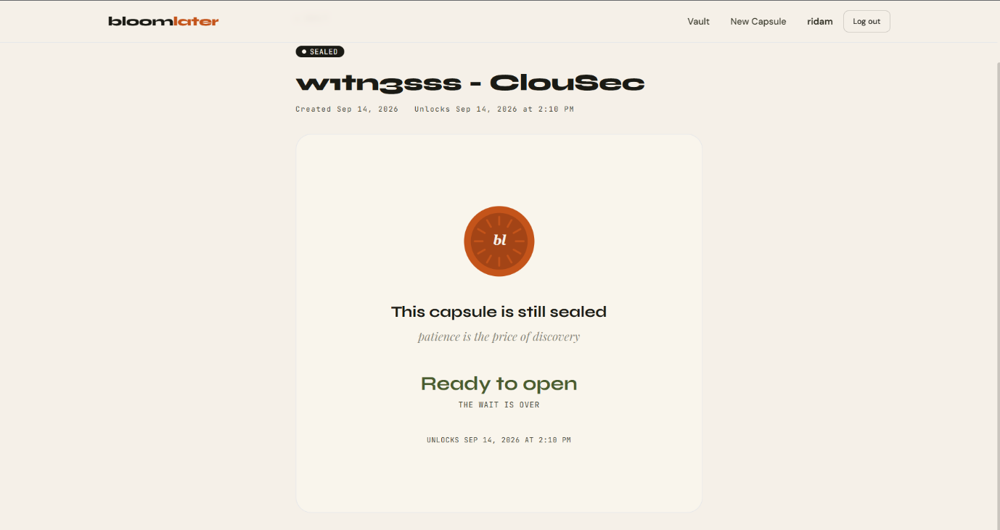

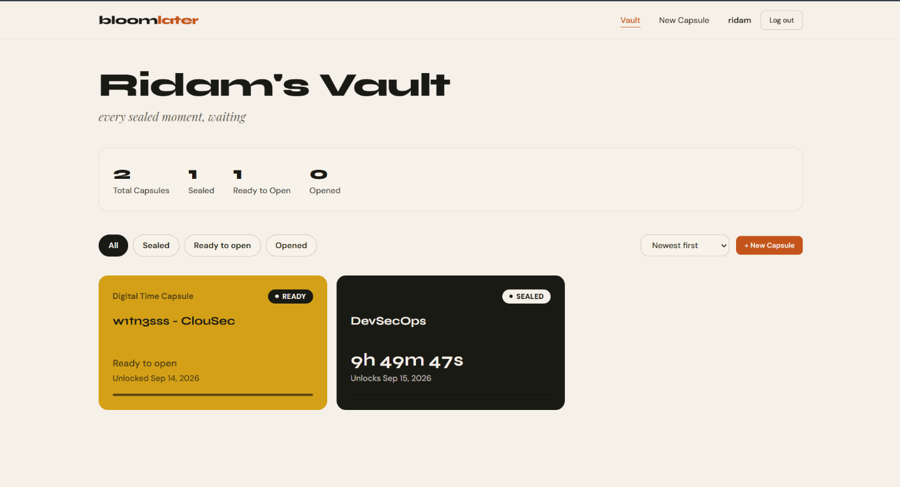

A scheduled job in the backend checks once a minute for sealed capsules whose unlock time has passed. It changes them to `unlockable`; it does not open them automatically. Opening a capsule is still a user action.

## The Pipeline at a Glance

The delivery flow is built around a simple separation: Jenkins builds and checks the application, while Argo CD applies the version described in Git to the cluster. Jenkins updates the Kubernetes image tags in the repository, but it does not run `kubectl` against the cluster as part of deployment.

```text
Developer pushes to GitHub (main)
              |
              v
          Jenkins CI
              |
              +--> Checkout source
              +--> Install frontend and backend dependencies
              +--> Lint checks
              +--> OWASP Dependency-Check and Trivy filesystem scan
              +--> SonarQube analysis and quality gate
              +--> Build frontend and backend Docker images
              +--> Trivy image scans
              +--> Push versioned images to Docker Hub
              |
              v
 Jenkins updates image tags in k8s/ and pushes a GitOps commit
              |
              v
    Argo CD detects the repository change
              |
              v
 Kubernetes pulls the new images and updates the workloads
              |
              v
 Prometheus scrapes targets; Grafana displays cluster metrics
```

This is the part I wanted to get right. A successful image build should not require Jenkins to hold direct cluster access just to deploy it. The new image version is recorded in Git, and Argo CD takes care of reconciling the cluster with that desired state.

## What Happens After a Push

### 1. Jenkins Runs the CI Pipeline

The `Jenkinsfile` is the pipeline definition. When a build starts, Jenkins checks out the `main` branch and installs dependencies for the frontend and backend in parallel. It then runs their lint commands, followed by the security and code-quality stages.

The pipeline has a 60-minute timeout, timestamps its output, keeps the latest ten builds, and disables concurrent runs. Those settings help keep the job output readable and avoid two builds trying to update the same deployment manifests at once.

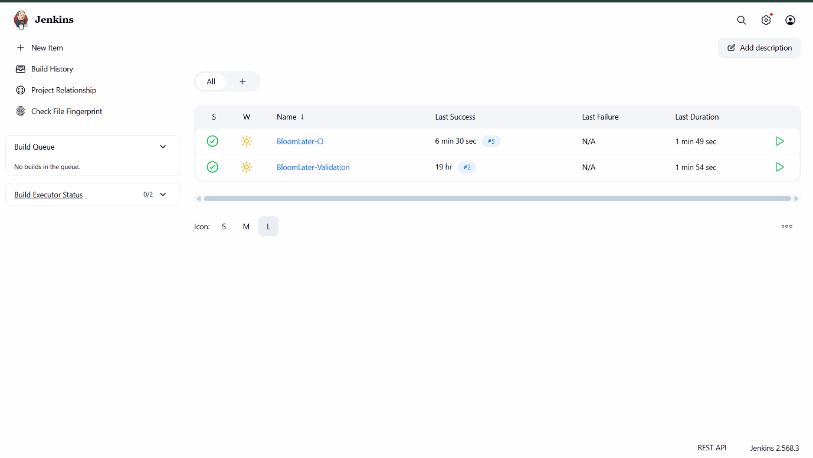

The repository's Git history also shows the automated GitOps commit created by Jenkins after a build. That commit is the handoff between CI and the deployment controller.

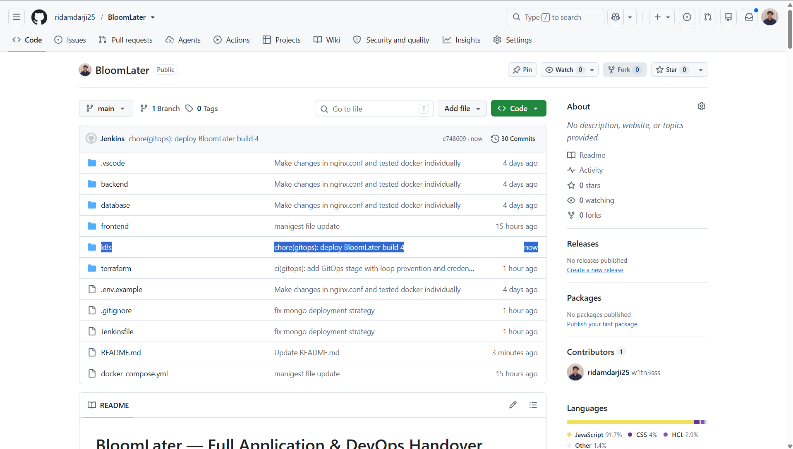

### 2. Code Quality and Security Checks

The pipeline checks the source before publishing the new images. OWASP Dependency-Check scans the frontend and backend dependencies. Trivy scans the project filesystem for HIGH and CRITICAL findings. SonarQube analyses the application source, and Jenkins waits for the SonarQube quality gate before moving on.

The current `Jenkinsfile` treats Dependency-Check and Trivy findings as an `UNSTABLE` stage while allowing the overall build to continue. The SonarQube quality gate is different: it is configured to abort the pipeline if the gate does not pass. That distinction matters, so I am documenting the current behaviour rather than describing every scanner as a hard blocking gate.

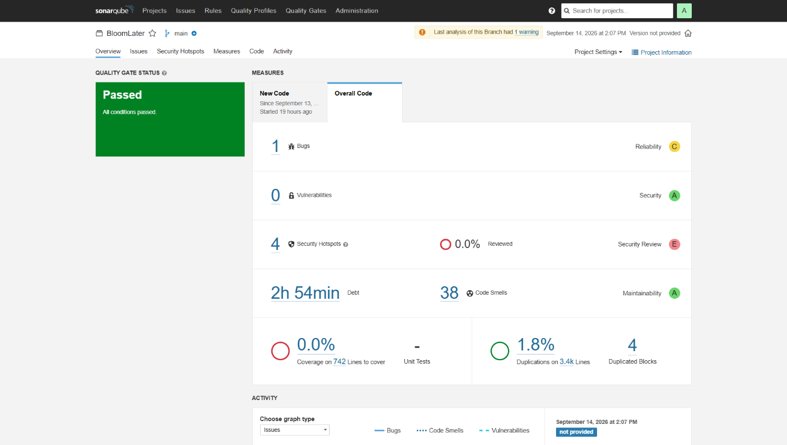

The screenshot is a record of that particular analysis, not a claim that the application has no bugs or that every possible security issue is covered. A scanner is useful evidence, but it is not a substitute for tests and review.

### 3. Build and Publish the Images

Once the required checks have completed, Jenkins builds the backend and frontend Docker images in parallel. The backend image is `riamtech/bloom-backend`; the frontend image is `riamtech/bloom-frontend`. Each image is tagged with the Jenkins build number and also tagged as `latest`.

The frontend build receives `/api` as its API base path, so it can send API requests through the application ingress rather than depending on a hard-coded local address. Jenkins logs into Docker Hub using a stored Jenkins credential, pushes both tags, and logs out again.

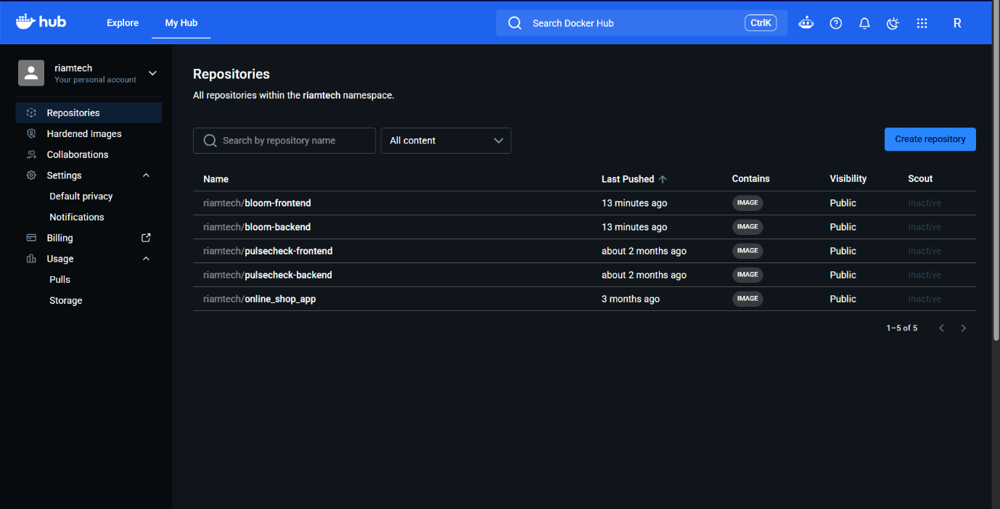

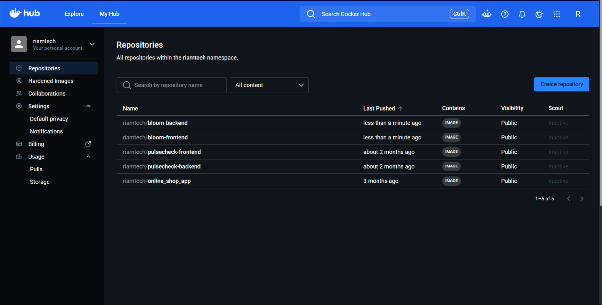

The build-number tag is the one used for deployment. It lets the Kubernetes manifest point to a specific build instead of relying on a moving `latest` tag.

### 4. GitOps Hands Off Deployment to Argo CD

After publishing the images, Jenkins edits the image references in `k8s/backend/deployment.yml` and `k8s/frontend/deployment.yml`, replacing the old tags with the current build number. It commits those changes with a message beginning `chore(gitops):` and pushes the commit to `main`.

The pipeline checks the latest commit message first. If it is already a GitOps commit, it skips the manifest-update stage. That guard prevents the automatic commit from repeatedly triggering another identical manifest update.

Argo CD watches the repository path configured for the BloomLater application. It detects the new commit and reconciles the manifests with the cluster. This keeps the source of truth in Git: the repository records which image version should run, and Argo CD works to make the cluster match it.

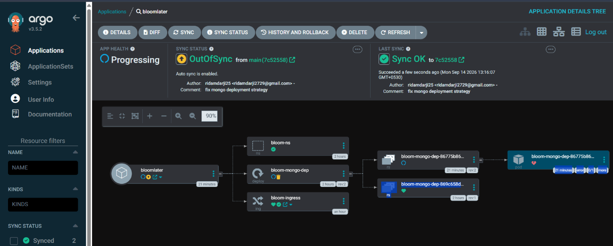

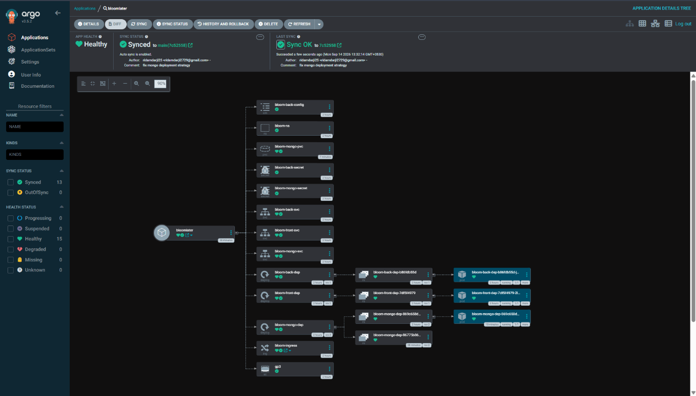

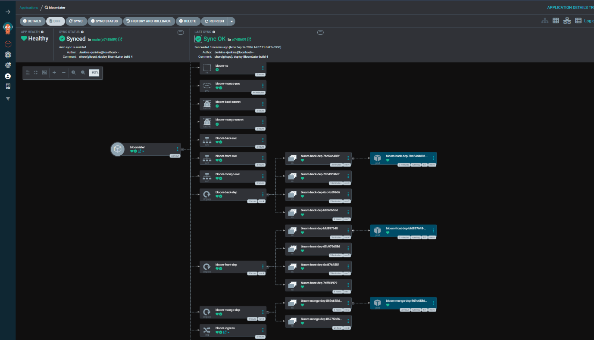

The GitOps commit can also be inspected directly in GitHub. In the deployment manifest, the image reference includes the build number written by Jenkins.

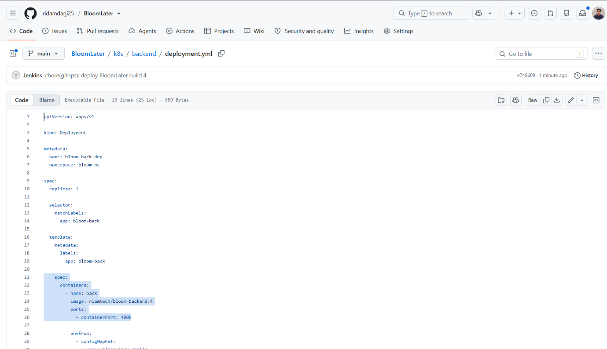

### 5. Kubernetes Runs the Application

BloomLater runs on Amazon EKS. The frontend, backend, and MongoDB are deployed separately, with Kubernetes Services for internal traffic and an Ingress to route requests to the appropriate application component. The MongoDB workload uses a PersistentVolumeClaim, so the database data is stored on persistent storage rather than only in the container's writable layer.

MongoDB uses the `Recreate` deployment strategy in this configuration. Its claim uses `ReadWriteOnce`, so replacing the pod by starting another one first can create a volume-attachment conflict. `Recreate` lets the existing pod stop and release the volume before the replacement starts. It is a practical choice for this single-replica database setup, though it also means MongoDB can be unavailable briefly during a replacement.

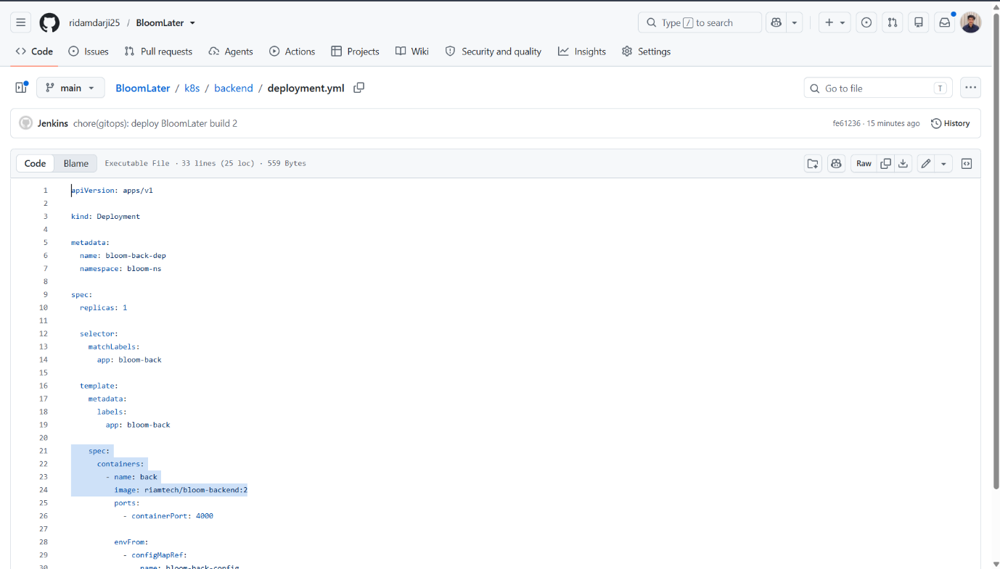

The Argo CD screenshots above show the resources in the cluster after synchronization. They are included as a view of the captured deployment state, rather than a promise that the cluster is still running at the time someone reads this README.

### 6. Monitoring with Prometheus and Grafana

After deployment, Prometheus provides the target-health view and Grafana gives a dashboard view of Kubernetes resource usage. The Prometheus screenshot shows monitoring targets in an `UP` state, while the Grafana screenshot shows CPU and memory information for namespaces including `bloom-ns`, `argocd`, `monitoring`, and `kube-system`.

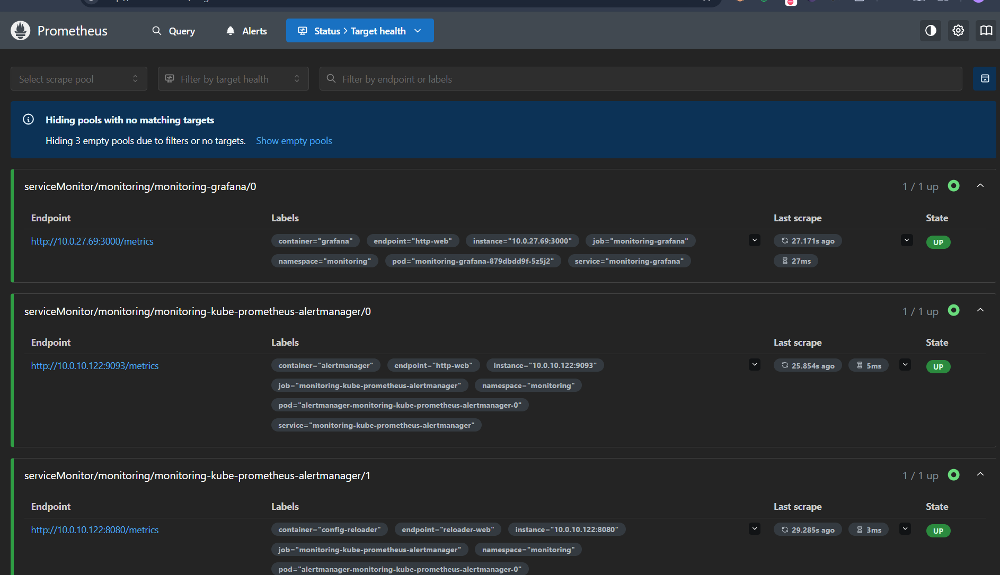

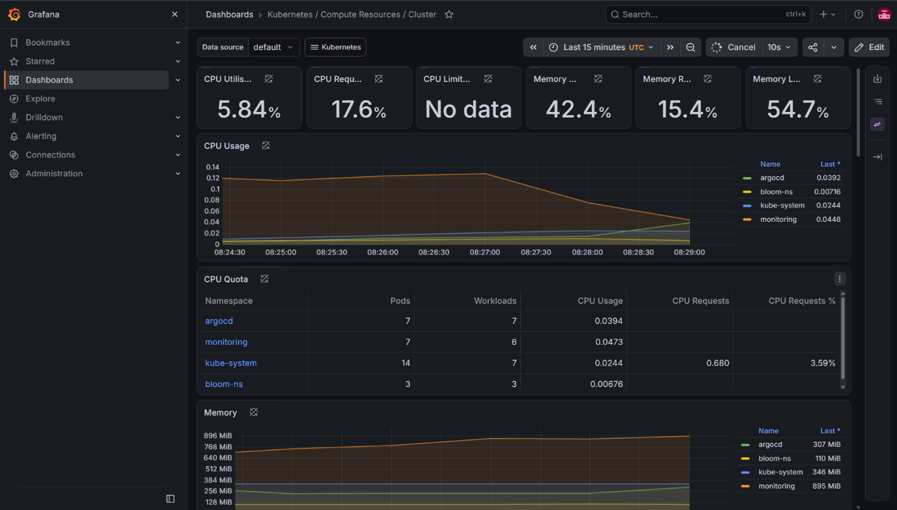

This is the final part of the flow. Getting a deployment to `Synced` is useful, but I also want to be able to check the workloads and see whether the cluster is reporting metrics after the rollout.

## Application Flow

The CI/CD pipeline delivers the application, but the main application behaviour is straightforward:

1. A user signs in and creates a capsule containing a message or memory.
2. The capsule is saved with its chosen unlock time and a sealed state.
3. The backend's scheduled job checks each minute for sealed capsules whose unlock time has passed.
4. Matching capsules move to the `unlockable` state.
5. The owner can then open the capsule through the application.

The job is intentionally separate from the act of opening a capsule. Time passing makes the capsule available; it does not automatically reveal the contents.

## Technology Stack

| Area | Technology | What it does here |
|---|---|---|
| Frontend | React, Vite | Capsule creation, vault, countdown and reveal interface |
| Backend | Node.js, Express | API, authentication and capsule operations |
| Database | MongoDB | User and capsule data |
| Authentication | JWT | Authenticated application requests |
| Containers | Docker | Packages frontend and backend for deployment |
| CI | Jenkins | Runs checks, builds images and updates image tags |
| Code quality | SonarQube | Analyses the source and supplies a quality gate |
| Dependency security | OWASP Dependency-Check | Checks project dependencies for known vulnerabilities |
| Filesystem and image scanning | Trivy | Scans source files and built images for HIGH and CRITICAL findings |
| Registry | Docker Hub | Stores the versioned frontend and backend images |
| Infrastructure | Terraform, AWS | Provisions the AWS and EKS infrastructure |
| Runtime | Amazon EKS, Kubernetes | Runs the application workloads and services |
| Ingress | ingress-nginx | Routes incoming application requests |
| GitOps / CD | Argo CD | Reconciles cluster resources from the repository |
| Monitoring | Prometheus, Grafana | Exposes target health and cluster resource metrics |

## Repository Layout

```text
BloomLater/
├── backend/
│   ├── Dockerfile
│   └── src/
│       ├── controllers/
│       ├── middleware/
│       ├── models/
│       ├── routes/
│       └── jobs/
│           └── unlockCapsules.job.js
├── frontend/
│   ├── Dockerfile
│   ├── nginx.conf
│   └── src/
├── database/
│   └── seed.js
├── k8s/
│   ├── backend/
│   ├── frontend/
│   ├── mongo/
│   ├── ingress.yaml
│   └── namespace.yml
├── terraform/
├── Jenkinsfile
├── docker-compose.yml
└── README.md
```

## A Few Implementation Details

**The GitOps update is deliberately a Git change.** Jenkins updates the deployment manifests and pushes them back to GitHub. Argo CD is responsible for applying the desired state, which avoids giving the CI job direct cluster-deployment commands.

**The database is treated as a stateful workload.** MongoDB has its own Deployment, Service, Secret, and PersistentVolumeClaim. Keeping its data on persistent storage is important because replacing a pod should not mean losing the database by default.

**The image tags link a build to a deployment.** Jenkins tags each image with the build number and writes that number into the manifests. It is easier to identify what is meant to be running when the deployment points to a specific version.

**Monitoring has a place in the delivery story.** Prometheus target health and Grafana resource charts give a way to inspect the environment after Argo CD has synced the change, instead of stopping the story at a green build.

## Lessons from Building It

A few issues took more time than expected and helped me understand the system better.

**Argo CD was not picking up manifests inside a subdirectory.** The MongoDB resources lived under `k8s/mongo/`, but the Application was not configured to recurse into subdirectories. The result was confusing: a sync could look fine while those manifests were not being tracked. Enabling recursive directory discovery made Argo CD include the nested resources.

**A MongoDB major-version downgrade caused startup failures.** The existing persistent volume contained data written by MongoDB 7, while a later deployment attempted to run MongoDB 4.4. The older server could not read the newer data format and exited. In the non-production environment, the way forward was to recreate the database storage rather than attempting an unsupported in-place downgrade. That is destructive, so in a real environment the data would need to be backed up and migrated through a supported upgrade/downgrade plan.

**A PVC can remain in `Terminating` while a pod still uses it.** Kubernetes protection finalizers prevent a claim from being removed while it is still in use. Checking which pod mounts the claim and removing the pod first is the safer sequence than immediately forcing the finalizer away.

These were separate problems, even though they appeared during the same deployment work. One was about MongoDB data compatibility; the other was about which manifests Argo CD was actually tracking. Fixing a symptom in one layer does not automatically fix the other layer.

## Notes Before Running It

This repository is a working project and a record of the setup I built. It is not a one-command production deployment. You will need an AWS account, appropriate IAM permissions, Terraform backend configuration, Jenkins tools and credentials, Docker Hub access, SonarQube configured in Jenkins, and Argo CD pointed at the correct repository and path.

The Jenkins pipeline currently uses credentials stored in Jenkins for GitHub, Docker Hub, the NVD API, and SonarQube. Do not copy real secrets into the repository. Use your own credentials and replace environment-specific values before running it.

The AWS resources used by EKS, worker nodes, load balancers, persistent storage, and networking can incur charges. Shut the environment down when you are finished testing it, and check what Terraform will remove before running `terraform destroy`.

---
